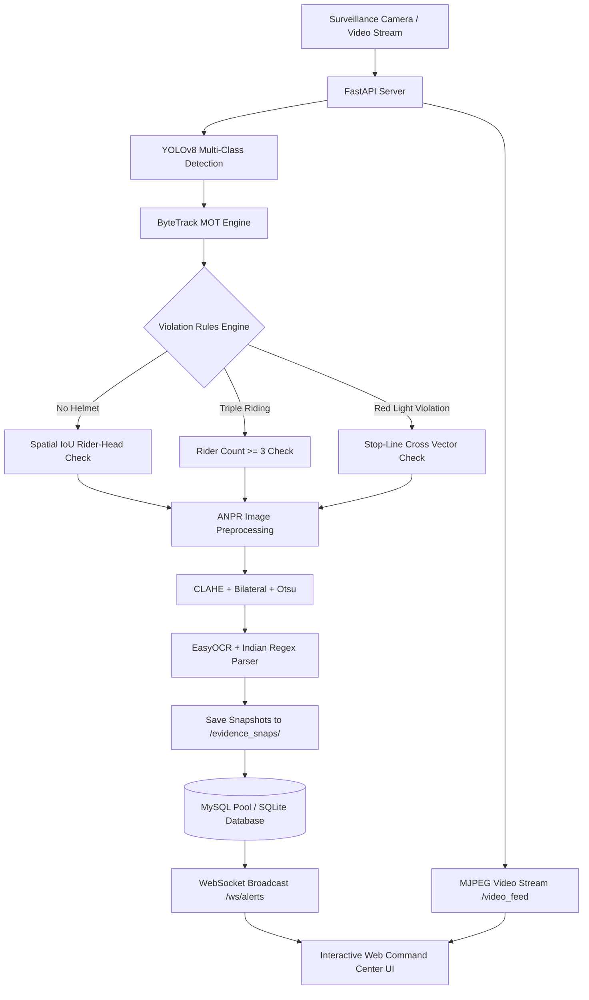

<div align="center">

# 🚦 AI ANPR & Automated E-Challan Traffic Enforcement System

### *Real-Time Vehicle Tracking, Helmet & Red-Light Infraction Detection, and License Plate Recognition*

[](https://python.org)
[](https://fastapi.tiangolo.com)
[](https://ultralytics.com)
[](https://opencv.org)
[](https://github.com/JaidedAI/EasyOCR)
[](https://opensource.org/licenses/MIT)

[Key Features](#-key-features) •
[System Architecture](#-system-architecture) •
[Installation](#-installation--setup) •
[Quick Start](#-quick-start) •
[API Reference](#-api-endpoints) •
[ANPR Pipeline](#-indian-license-plate-anpr-pipeline)

</div>

---

## 📖 Overview

The **AI ANPR & Automated E-Challan System** is an end-to-end, high-performance intelligent transportation system (ITS) designed for automated traffic surveillance and digital penalty generation.

By marrying **YOLOv8** object detection with **ByteTrack** multi-object tracking, spatial **IoU (Intersection-over-Union)** infraction heuristics, **OpenCV** image enhancement, and **EasyOCR**, the system automatically detects traffic violations, recognizes vehicle registration numbers conforming to Indian standards, saves cryptographic-ready evidence frames, and broadcasts alerts over **WebSockets** to a dark-mode **Command Center Dashboard**.

---

## ⚡ Key Features

* **Real-Time Multi-Object Tracking (MOT)**:
  * Detects and classifies vehicles (`car`, `motorcycle`, `bus`, `truck`) and `person` / `helmet` at **25–30 FPS**.
  * Employs **ByteTrack** to assign persistent tracking IDs across frame occlusions and calculate centroid motion vectors.

* **Automated Violation Detection Rules (IoU Heuristics)**:
  * 🪖 **No-Helmet Violation**: Associates riders to motorcycles via spatial IoU; inspects the rider's upper-head ROI to identify absence of a safety helmet.
  * 👥 **Triple-Riding Violation**: Flags two-wheelers carrying $\ge 3$ overlapping riders.
  * 🔴 **Red-Light / Stop-Line Crossing**: Tracks vehicle bounding boxes crossing configurable stop lines while the traffic signal is in a `RED` interval.

* **Advanced ANPR with Indian Registration Plate Regex**:
  * Multi-stage image enhancement pipeline: **Grayscale** $\to$ **Bilateral Filtering** $\to$ **CLAHE (Contrast Limited Adaptive Histogram Equalization)** $\to$ **Otsu's Adaptive Thresholding** $\to$ **Morphological Closing**.
  * Positional OCR character disambiguation ($O \leftrightarrow 0, I \leftrightarrow 1, B \leftrightarrow 8, S \leftrightarrow 5, Z \leftrightarrow 2$).
  * Regex validation supporting Indian vehicle registration formats (`DL 01 AB 1234`, `MH 12 DE 1433`, etc.).

* **Tactical Command Center Dashboard**:
  * Low-latency **MJPEG live video stream** (`/video_feed`).
  * **Interactive HTML5 Canvas ROI Tool**: Click and drag directly on the live video stream to configure or calibrate the Stop-Line trigger zone.
  * **Real-Time WebSocket Feed**: Live incident alerts with synthesized futuristic audio chimes (Web Audio API).
  * **Official E-Challan Inspector & Printer**: Side-by-side evidence inspection (Full Context Scene Snap + Zoomed Plate Crop) with printable physical challan receipts.

* **High-Throughput Database Layer**:
  * **MySQL Connection Pooling** with batch query inserts for zero-latency video processing.
  * **Resilient Embedded SQLite Fallback**: Automatically switches to an embedded SQLite database if MySQL is not running locally.

---

## 🏗️ System Architecture



---

## 📁 Repository Structure

```text
anpr_echallan_system/
├── backend/
│   ├── main.py              # FastAPI server, MJPEG streaming & WebSocket routes
│   ├── cv_pipeline.py       # YOLOv8, ByteTrack, IoU logic & EasyOCR preprocessing
│   ├── database.py          # MySQL connection pool, batch inserts & SQLite fallback
│   └── weights/             # Model weights directory (yolov8n.pt, custom models)
├── frontend/
│   ├── index.html           # Dark-mode Command Center layout
│   ├── styles.css           # CSS Grid tactical styling, glassmorphism & print rules
│   └── app.js               # WebSocket listener, Canvas ROI drawing & Fetch API
├── evidence_snaps/          # High-resolution saved evidence snaps & plate crops
├── traffic.mp4              # Sample Indian traffic video for testing
├── requirements.txt         # Python package dependencies
└── README.md                # Project documentation
```

---

## 🛠️ Installation & Setup

### Prerequisites
* **Python 3.9+** (Tested on Python 3.9, 3.10, 3.11)
* **MySQL Server** *(Optional — system automatically defaults to embedded SQLite if MySQL is absent)*
* **FFmpeg** *(Optional — for custom video generation)*

### 1. Clone the Repository
```bash
git clone https://github.com/your-username/anpr-echallan-system.git
cd anpr-echallan-system
```

### 2. Create and Activate a Virtual Environment
```bash
# Windows
python -m venv venv
.\venv\Scripts\activate

# Linux / macOS
python3 -m venv venv
source venv/bin/activate
```

### 3. Install Dependencies
```bash
pip install --upgrade pip
pip install -r anpr_echallan_system/requirements.txt
```

---

## ⚙️ Database Configuration (Optional)

By default, the application runs out-of-the-box using an embedded SQLite database (`echallan_local.db`). 

To utilize production **MySQL**, set the following environment variables:

#### On Windows (PowerShell):
```powershell
$env:MYSQL_HOST="localhost"
$env:MYSQL_USER="root"
$env:MYSQL_PASSWORD="your_password"
$env:MYSQL_DATABASE="echallan_db"
$env:MYSQL_PORT="3306"
```

#### On Linux / macOS:
```bash
export MYSQL_HOST="localhost"
export MYSQL_USER="root"
export MYSQL_PASSWORD="your_password"
export MYSQL_DATABASE="echallan_db"
export MYSQL_PORT=3306
```

---

## 🚀 Quick Start

### 1. Launch the Server
From the root directory, run:
```bash
python run.py
```
*Or directly via Uvicorn:*
```bash
cd anpr_echallan_system/backend
uvicorn main:app --host 0.0.0.0 --port 8000 --reload
```

### 2. Open the Command Center
Navigate in your browser to:
```
http://localhost:8000
```

---

## 🖥️ Command Center Walkthrough

| Feature | Description |
| :--- | :--- |
| **Live MJPEG Feed** | Displays 720p surveillance stream with real-time bounding boxes, tracking IDs, and signal indicators. |
| **Interactive Canvas ROI** | Click **"Draw Stop Line"** to click 2 points on the road to set a new violation line. Click **"Save ROI"** to apply it instantly. |
| **Signal Switcher** | Toggle traffic light between `RED` and `GREEN` to simulate intersection signal cycles. |
| **Instant Test Violation** | Click **"+ Test Violation"** to immediately dispatch a simulated infraction through the pipeline to verify WebSockets and audio chimes. |
| **E-Challan Audit Table** | Filter by Plate Number, Violation Type (`NO_HELMET`, `RED_LIGHT_VIOLATION`, `TRIPLE_RIDING`), or Payment Status. |
| **Official Receipt Modal** | Inspect full-scene snapshot and zoomed plate crop. Click **"Print Challan Receipt"** to print or export as PDF. |

---

## 🔍 Indian License Plate ANPR Pipeline

Indian registration numbers follow standard syntax under the Motor Vehicles Act:
$$\underbrace{\text{DL}}_{\text{State (2 Letters)}}\;\underbrace{01}_{\text{RTO District}}\;\underbrace{\text{AB}}_{\text{Series}}\;\underbrace{1234}_{\text{Unique Number (4 Digits)}}$$

### Optical Ambiguity Resolution Matrix
The pipeline applies positional OCR disambiguation based on character index:
* **In Digit Positions (Indices 2-3 & last 4)**:  
  `O` $\to$ `0` • `I` $\to$ `1` • `Z` $\to$ `2` • `S` $\to$ `5` • `B` $\to$ `8` • `D` $\to$ `0`
* **In Letter Positions (Indices 0-1 & Series)**:  
  `0` $\to$ `O` • `1` $\to$ `I` • `8` $\to$ `B` • `5` $\to$ `S` • `2` $\to$ `Z`

---

## 📡 API Endpoints

| Method | Endpoint | Description |
| :--- | :--- | :--- |
| `GET` | `/` | Serves the Command Center HTML5 dashboard |
| `GET` | `/video_feed` | MJPEG video streaming route (`multipart/x-mixed-replace`) |
| `WS` | `/ws/alerts` | WebSocket connection for real-time violation event broadcasting |
| `GET` | `/api/violations` | Paginated list of challans with plate/type/status filters |
| `GET` | `/api/violations/{id}` | Detailed challan record by ID |
| `PATCH` | `/api/violations/{id}/status` | Updates challan status (`PAID`, `DISPUTED`, `PENDING`) |
| `GET` | `/api/stats` | Aggregated metrics (total vehicles, fines, OCR accuracy) |
| `POST` | `/api/roi` | Updates dynamic stop-line coordinates from Canvas |
| `POST` | `/api/signal` | Sets traffic signal state (`RED`, `GREEN`, `YELLOW`) |
| `POST` | `/api/trigger-test-violation` | Developer test trigger for WebSocket verification |

---

## 🤝 Contributing

Contributions, issues, and feature requests are welcome!
1. Fork the Project
2. Create your Feature Branch (`git checkout -b feature/AmazingFeature`)
3. Commit your Changes (`git commit -m 'Add some AmazingFeature'`)
4. Push to the Branch (`git push origin feature/AmazingFeature`)
5. Open a Pull Request

---

## 📄 License

Distributed under the **MIT License**. See `LICENSE` for more information.

---

<div align="center">
  <sub>Built with ❤️ for intelligent traffic surveillance and public road safety.</sub>
</div>

